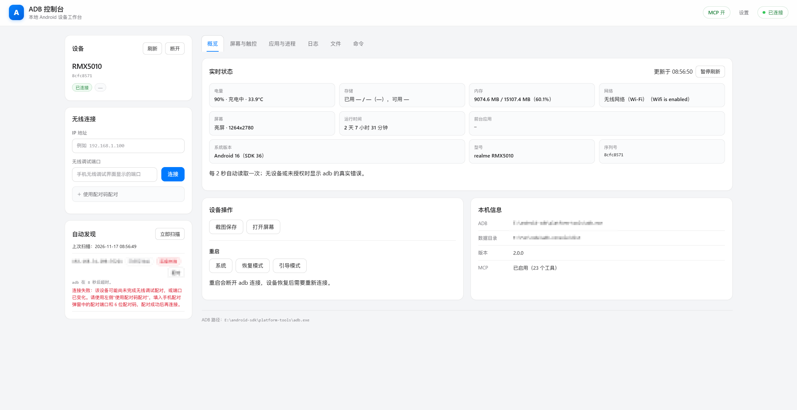
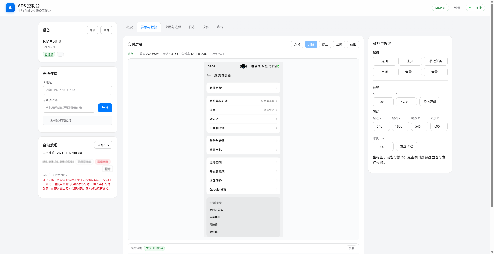
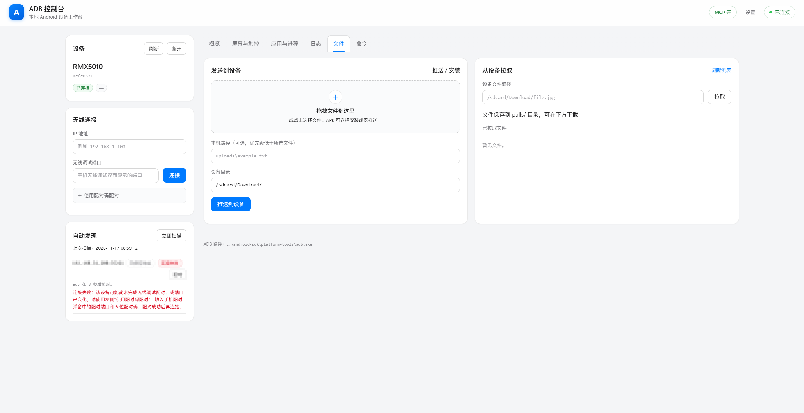
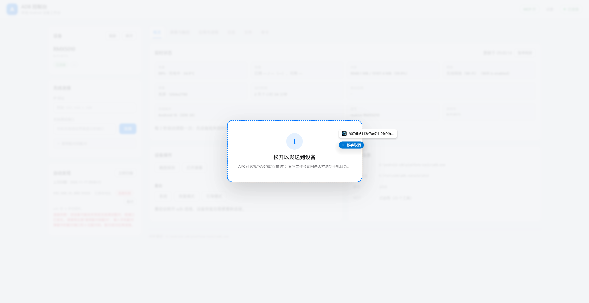

# ADB Console（ADB 控制台）

本地 Android 设备可视化测试工作台：中文网页控制台 + 桌面托盘 + 内置 MCP 服务，所有 adb 命令都在本机执行。

原始 stdout / stderr / 退出码原样返回，失败时不伪造成功。服务只监听 `127.0.0.1`。

## 功能一览

- **设备管理**：USB / 无线设备、mDNS 自动发现、自动连接、手动连接、无线配对、断开。
- **实时状态**：电量、存储、内存、网络、屏幕、前台应用、系统版本等，2 秒自动刷新。
- **实时屏幕**：连续取帧，显示帧率 / 延迟 / 分辨率；点击画面映射为设备坐标轻触；支持顶层浮动窗口。
- **日志**：实时 logcat 流，支持关键字 / 级别过滤、自动滚动、暂停、清空。
- **应用与进程**：包列表筛选、启动 / 停止 / 清除数据 / 卸载；`ps -A` 进程列表可搜索。
- **安装**：上传 APK 或填写本机路径安装。
- **文件**：推送 / 拉取设备文件；把文件直接拖进页面即可分流——APK 可“安装 / 仅推送 / 取消”，其它文件可选择“推送到手机目录 / 取消”。
- **触控与按键**：返回、主页、最近任务、电源、音量、坐标轻触、滑动。
- **重启**：系统 / 恢复模式 / 引导模式。
- **桌面体验**：exe 启动后常驻系统托盘，可在设置中用系统文件对话框选择 `adb.exe`；重复双击不会新建进程或端口，而是直接打开已运行的控制台。
- **MCP 服务**：与主程序同进程运行，**默认关闭**，开启前有风险二次确认。

## 界面预览

### 概览



### 屏幕与触控



### 文件传输与拖拽发送

| 文件页 | 拖拽文件到页面 |
| --- | --- |
|  |  |

## 快速开始（源码）

要求：Python 3.12+，本机可用的 adb（Android Platform Tools）。

```bash
pip install -r requirements.txt
python app.py        # 仅网页服务
# 或
python run.py        # 网页 + 系统托盘
```

打开启动日志中打印的地址（默认 `http://127.0.0.1:5010`；被占用时自动顺延到 5010–5049）。

## 打包为 exe（Windows）

```bash
pip install -r requirements.txt
pip install pyinstaller
python build.py
```

产物为 `dist/ADBConsole.exe`：

- 双击启动后自动打开浏览器，并在系统托盘显示图标；
- 托盘菜单可“打开控制台 / 在浏览器中打开 / 退出 ADB 控制台”；
- 关闭浏览器不会退出程序，请从托盘菜单退出；
- 运行时数据（配置、日志、截图、拉取文件等）保存在 exe 同目录。

## 页面布局

- 顶栏：MCP 状态、设置、设备连接状态。
- 左侧：设备概览、无线连接 / 配对、自动发现。
- 主区按标签页分区：**概览 / 屏幕与触控 / 应用与进程 / 日志 / 文件 / 命令**，避免所有功能堆在同一屏。

## 设置

点击右上角“设置”：

- **ADB 可执行文件**：可手动填写，或点击“浏览…”弹出系统文件对话框选择 `adb.exe`；支持先“测试”再“保存”。
- **MCP 服务**：与主程序同进程运行，无需单独启动；默认关闭。开启时会弹出风险确认，说明 AI 客户端可执行 shell、安装/卸载应用、重启设备等操作。

adb 路径按以下优先级解析：`config.json`（页面保存）> 环境变量 `ADB_PATH` > 系统 `PATH`。

## MCP 服务

MCP 已合并进主程序，不再需要单独启动 `mcp_server.py`：

- 地址：`http://127.0.0.1:<端口>/mcp`
- 传输：
  - **Streamable HTTP**：`POST /mcp`（可返回 JSON 或 SSE 流）、`GET /mcp`（SSE keepalive）、`DELETE /mcp`（结束会话）
  - **旧版 HTTP+SSE**：`GET /sse` 获取 endpoint，`POST /messages?session_id=...` 发送消息
  - **stdio**：仅兼容入口 `mcp_server.py`
- 协议：JSON-RPC 2.0；支持 `initialize`、`notifications/initialized`、`ping`、`logging/setLevel`、`tools/list`、`tools/call`
- 开关：页面“设置 → MCP 服务”，默认关闭；关闭时所有 MCP 入口返回 403
- 鉴权：开启 MCP 时自动生成访问令牌，客户端必须携带请求头（默认 `Authorization: Bearer <token>`）才能调用；头名称可在设置中修改，令牌可重新生成，未授权请求返回 401
- 23 个工具：`adb_status`、`adb_devices`、`adb_connect`、`adb_pair`、`adb_shell`、`adb_install`、`adb_screenshot`、`adb_logcat`、`adb_tap`、`adb_swipe`、`adb_reboot` 等，详见 [docs/MCP.md](docs/MCP.md)。

SSE 示例：`POST /mcp` 携带 `Accept: text/event-stream` 即可获得 `text/event-stream` 响应；旧版客户端连接 `/sse` 即可。`/mcp` 的 `GET` 在带 SSE Accept 时保持 keepalive 通道，否则返回传输能力说明 JSON。

鉴权示例（客户端自定义请求头）：

```json
{
  "Authorization": "Bearer <设置页显示的令牌>"
}
```

兼容入口：仅给只能以 stdio 启动的客户端保留 `mcp_server.py`（内部复用同一网关），它不是默认启动方式。

## HTTP API

与网页功能对齐的 REST API，详见 [docs/API.md](docs/API.md)。

## 日志

- 主程序日志：`logs/app.log`（按日轮转，保留 14 天）。
- 兼容 stdio MCP 日志：`logs/mcp_server.log`。

## 代码结构

```
adb_core.py              adb 引擎层：设备、屏幕、日志、文件、shell
mcp_tools.py             MCP 工具清单与调度（工具层）
app.py                   源码网页入口（兼容 python app.py）
run.py                   桌面入口：Web 服务 + 托盘 + 退出控制
adbconsole/
  config.py              config.json 读写（MCP 开关等）
  mcp/
    gateway.py           进程内 MCP JSON-RPC 网关
    stdio.py             仅兼容 stdio 客户端的传输层
  services/
    dialogs.py           系统文件对话框（选择 adb.exe）
    tray.py              系统托盘图标
  web/
    __init__.py          Flask 应用工厂、日志、端口
    common.py            统一错误包装与请求工具
    routes/
      pages.py           页面与下载
      devices.py         设备发现 / 连接 / 配对
      device.py          设备信息 / 进程 / 应用 / 安装
      screen.py          实时屏幕 / 截图 / 触控
      logcat.py          日志流
      files.py           推送 / 拉取
      shell.py           shell / 重启
      settings.py        adb 路径 / MCP 开关
      mcp.py             POST /mcp
templates/               页面模板
static/                  样式与前端脚本
docs/                    API 与 MCP 文档
logs/                    运行日志（git 忽略）
screenshots/             截图（git 忽略）
pulls/                   拉取文件（git 忽略）
uploads/                 上传文件（git 忽略）
config.json              本机配置：adb 路径、MCP 开关（git 忽略）
known_devices.json       自动发现的已知设备地址（git 忽略）
```

## 路径与安全

- 所有 adb 调用使用固定 argv 列表，不使用 `shell=True`。
- 推送的本机路径必须位于项目目录内；上传文件保存到 `uploads/`。
- 拉取文件只能写入 `pulls/`，文件名会清理，下载接口拒绝目录穿越。
- 安装 APK 允许填写本机任意可读的 `.apk` 路径（测试工作台的显式输入）。
- 服务只监听 `127.0.0.1`，不对外网暴露。
- MCP 默认关闭，开启前必须确认风险；关闭后 `/mcp` 直接拒绝请求。
- adb 子进程最多并发 4 个；单个调用有超时。

## License

GNU General Public License v3.0（GPL-3.0）。完整协议文本见 [LICENSE](LICENSE)。
